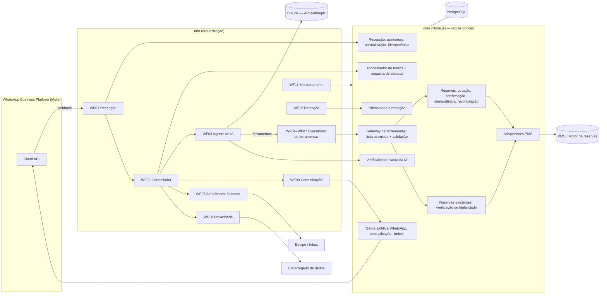
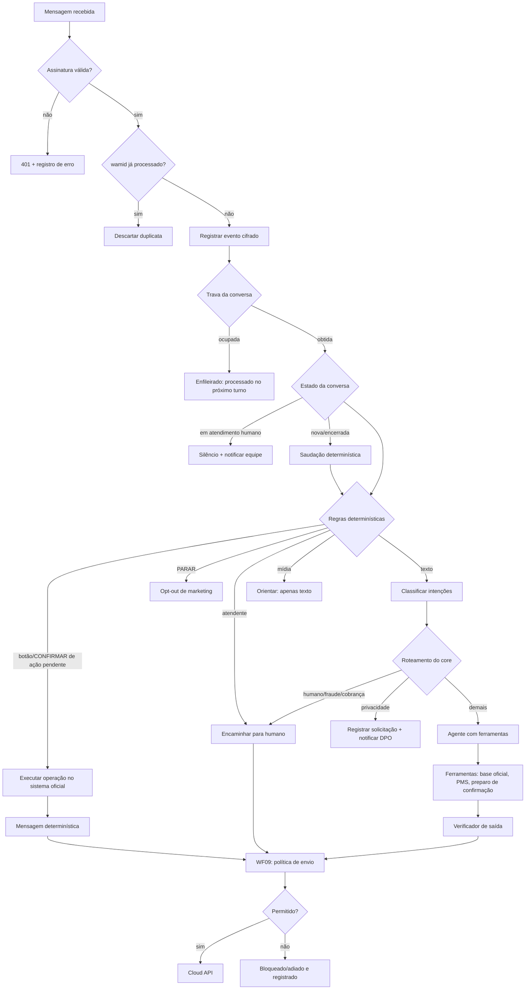

# 04 — Arquitetura da solução

## 1. Visão geral

A solução separa **orquestração** (n8n), **inteligência de linguagem** (modelo Claude via n8n) e **regras críticas** (serviço `core` em Node.js). O princípio central é: *a IA conversa e sugere; o backend decide e executa*. Toda operação com efeito (consultar sistema oficial, preparar reserva, executar reserva, cancelar, enviar mensagem) passa por código determinístico, validado e auditado, independentemente do que o modelo gerar.



## 2. Componentes

| Componente | Tecnologia | Responsabilidade | Estado |
|---|---|---|---|
| Camada de comunicação | WhatsApp Cloud API (oficial) | Entrada/saída de mensagens, status, modelos | Cliente implementado; **sem conta configurada** |
| Orquestração | n8n 2.44.7 | 12 workflows (gatilhos, roteamento, chamadas ao core e ao modelo, alertas, agendamentos) | Gerados, importados e executados localmente |
| Modelo de linguagem | Claude Opus 5.5 (`claude-opus-5-5`) via nó Anthropic do n8n e chamada HTTP para classificação | Compreensão, extração, redação, escolha de ferramentas | Configurado; **não executado com chave real** |
| Core | Node.js 22, sem framework HTTP, `pg`, `ajv` | Assinatura, idempotência, estados, ferramentas, políticas, reservas, privacidade, auditoria, métricas | Implementado e testado |
| Banco operacional | PostgreSQL ≥ 14 (testado no 18) | Estado, auditoria, catálogo, cotações, reservas (sem PII de hóspede), privacidade | Migrações testadas |
| Integração hoteleira | Adaptador por driver (`simulado`, `rest`) | Isolar o agente do PMS; declarar capacidades | Simulado testado; REST testado contra servidor local; **PMS real pendente** |
| Notificações | Webhook de e-mail transacional | Link de verificação reforçada | Simulado; real pendente |

## 3. Decisões técnicas (resumo de ADRs)

**ADR-01 — Core separado do n8n para regras críticas.** Code nodes do n8n são difíceis de testar, versionar e proteger; e o n8n não deve virar repositório de dados pessoais. Consequência: o n8n só orquestra; as decisões estão em código com 120+ testes. As execuções do n8n guardam apenas erros (`saveDataSuccessExecution: none`) com poda em 7 dias.

**ADR-02 — A IA não executa operações irreversíveis.** Não existe ferramenta `confirmar_reserva` para o modelo. A IA só prepara um resumo; o core gera o texto (determinístico) com botões, e a execução ocorre quando chega um evento do próprio cliente (`acao:<id>:confirmar` ou "CONFIRMAR") vinculado àquela ação, dentro do prazo, com transição atômica de estado.

**ADR-03 — Mensagens críticas determinísticas.** Saudação (declaração de assistente virtual), resumos, confirmações, falhas e encaminhamentos vêm do catálogo `whatsapp/catalog.js`, não do modelo. Quando há mensagem oficial no turno, o texto livre do modelo é descartado.

**ADR-04 — Verificador de saída.** Toda resposta livre do modelo passa por `guardrails/outputCheck.js`: valores monetários precisam ter vindo de ferramentas oficiais no período; alegações de reserva criada/cancelada sem operação confirmada são bloqueadas; vazamento de instruções, alegação de ser humano, falsa urgência e número de cartão também.

**ADR-05 — PostgreSQL para idempotência, travas e contadores; sem Redis inicialmente.** Unicidade (`wamid`, chave de deduplicação, chave de idempotência), travas com lease (`UPDATE ... WHERE lock_ate <= now`), CAS de ações e contadores (`INSERT ... ON CONFLICT DO UPDATE`) foram testados sob concorrência real. Redis passa a ser recomendado quando: (a) > ~50 mensagens/s sustentadas; (b) latência de contadores impactar o p95; (c) várias réplicas do core disputarem as mesmas linhas. A interface do repositório permite trocar contadores/travas sem alterar o domínio.

**ADR-06 — Memória conversacional mínima no banco operacional.** Não se usa memória persistente do LangChain/n8n. O contexto por turno é: últimas 12 mensagens (conteúdo cifrado e com expiração de 30 dias, provisório), "dados já informados" (destino, datas, ocupação — sem PII) e intenções pendentes. Isso reduz custo, superfície de dados e permite apagar por política.

**ADR-07 — Classificação com saída estruturada.** A classificação de intenções usa chamada direta à API (`output_config.format` com JSON Schema), mais previsível que uma cadeia LangChain; o core valida as categorias e decide o roteamento. Falha do classificador não bloqueia o atendimento (o core trata como "sem intenção").

**ADR-08 — Ferramentas por domínio em sub-workflows.** O agente (WF03) chama `toolWorkflow` → WF04–WF08/WF10, que conferem a lista permitida do domínio e chamam o core, que valida novamente (defesa em profundidade). A lista de ferramentas do n8n é **gerada** do registro do core (`scripts/build-n8n-workflows.js`), evitando divergência.

**ADR-09 — Modelo e raciocínio.** Padrão `claude-opus-5-5` com raciocínio adaptativo (`thinkingMode: adaptive`, esforço `medium` no agente e `low` no classificador). Obrigatório: o nó Anthropic do n8n envia `thinking: disabled` por padrão, o que esse modelo rejeita (verificado no código do nó). Trocar por Sonnet 5.5 ou Haiku 4.5 é uma decisão de custo da rede (ver `25-estimativa-custos.md`).

**ADR-10 — Dados de hóspedes permanecem no PMS.** O core não replica cadastro de hóspedes. Dados coletados para a reserva ficam cifrados na ação pendente, são enviados ao PMS e apagados ao concluir/expirar (24 h no máximo, provisório).

## 4. Fluxo de atendimento



### Sequência de reserva

```mermaid
sequenceDiagram
  participant C as Cliente
  participant N as n8n
  participant IA as Claude
  participant K as Core
  participant P as PMS
  C->>N: "Quero reservar em SP de 10 a 12/12, 2 adultos"
  N->>K: iniciar turno
  N->>IA: classificar + agente
  IA->>K: consultar_disponibilidade
  K->>P: disponibilidade
  P-->>K: ofertas
  K-->>IA: opções (cotacao_id, totais)
  IA-->>C: apresenta opções (valores verificados)
  C->>N: "Quero a Standard; Maria Teste, e-mail"
  IA->>K: iniciar_reserva / registrar_dados_hospede
  IA->>K: solicitar_confirmacao_reserva
  K->>P: revalida preço/disponibilidade
  K-->>C: RESUMO determinístico + botões
  C->>N: toque em "Confirmar reserva"
  N->>K: iniciar turno (evento do cliente)
  K->>K: valida ação, prazo, conversa (CAS)
  K->>P: criar reserva (Idempotency-Key, valor esperado)
  P-->>K: confirmada + código
  K-->>C: confirmação com dados retornados pelo PMS
```

## 5. Integrações obrigatórias

1. WhatsApp Business Platform (Cloud API ou BSP autorizado).
2. PMS/motor de reservas com API (ou middleware que implemente `contracts/hotel-integration.openapi.yaml`).
3. Provedor do modelo de linguagem (Anthropic).
4. PostgreSQL gerenciado.
5. Canal de notificação da equipe e do encarregado (inbox/chat/e-mail).
6. Serviço de e-mail transacional (somente se `VERIFICACAO_REFORCADA_MODO=link_email`).

## 6. Riscos e dependências principais

| Risco | Impacto | Mitigação |
|---|---|---|
| PMS sem API ou sem idempotência | Reserva automática inviável ou com risco de duplicidade | Fluxo de reserva assistida por atendente; middleware com idempotência; capacidade `reserva` desligada |
| Mudanças de política/preço da Meta | Bloqueios de envio, custos | Política configurável, classificação de erros revisável, monitoramento de bloqueios |
| Alucinação do modelo | Informação incorreta | Ferramentas oficiais, verificador de saída, mensagens determinísticas, encaminhamento |
| Injeção de prompt | Vazamento/operação indevida | Travas no backend, lista permitida, verificação de titularidade, auditoria |
| Dados pessoais em execuções do n8n | Exposição | Não salvar execuções bem-sucedidas, poda, acesso restrito ao n8n |
| Ausência de política de privacidade/bases legais | Impedimento legal | Coleta bloqueada até configuração; inventário e matriz de riscos propostos |
| Versões do n8n/nós mudarem parâmetros | Workflows quebrados após atualização | Versão fixada; validação de importação e E2E local antes de atualizar |

## 7. Escalabilidade

- Core sem estado em memória (exceto métricas): várias réplicas atrás de balanceador; travas no banco.
- n8n em *queue mode* (Redis + workers) quando o volume justificar; os workflows não dependem de modo de execução.
- PostgreSQL: índices por conversa/tempo; retenção diária mantém tabelas pequenas.
- Limites de envio configuráveis por segundo e por destinatário.

## 8. Alternativas se a rede não tiver API de reservas

| Alternativa | Como funciona | Custos | Limitações |
|---|---|---|---|
| A. Somente informativo + reserva assistida | Assistente informa e coleta preferências; encaminha para atendente que reserva no PMS | Baixo (só operação) | Sem cotação automática; depende de equipe |
| B. Channel manager/motor com API | Usar o motor de reservas/channel manager que já distribui tarifas (muitos oferecem API de disponibilidade e reserva) | Assinatura do fornecedor + integração do middleware | Depende de contrato e escopo da API |
| C. Middleware próprio sobre o PMS | Integrador desenvolve o contrato `hotel-integration` sobre a interface disponível do PMS | Projeto de integração (estimar com o fornecedor do PMS) | Qualidade depende da interface do PMS |
| D. Link para o motor web | Assistente cota (se houver API de leitura) e envia link do motor oficial para concluir | Baixo | Conversão fora do WhatsApp |

Automação de interface gráfica (RPA) do PMS **não é recomendada** para reservas: frágil, difícil de garantir idempotência e de auditar.
