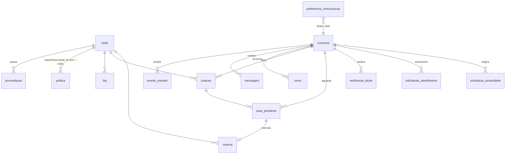

# 05 — Modelo de dados e dicionário de dados

Fonte de verdade: `db/migrations/001_schema.sql` (testado em PostgreSQL 18, UTF8). Papéis de acesso: `002_papeis_acesso.sql`.

Convenções: identificadores internos opacos e não sequenciais (`prefixo_` + 16 caracteres base64url) para dificultar enumeração; timestamps `timestamptz` em UTC; datas de hospedagem `date` (civil, no fuso do hotel); valores `numeric(12,2)` + moeda ISO 4217; colunas `*_cifrado` contêm AES-256-GCM (`v1.<chave>.<iv>.<tag>.<dados>`); `*_hash` contém HMAC-SHA256 com pepper.

## 1. Diagrama entidade-relacionamento

## 2. Separação lógica

| Grupo | Tabelas |
|---|---|
| Cadastro dos hotéis e acomodações | `hotel`, `acomodacao` |
| Informações comerciais/políticas/FAQ | `politica`, `faq` |
| Disponibilidade e tarifas (snapshot de cotação) | `cotacao` (disponibilidade nunca é armazenada como fonte; só a cotação apresentada) |
| Reservas (referência, sem PII) | `reserva`, `acao_pendente` |
| Conversas e mensagens | `conversa`, `mensagem`, `evento_entrada`, `turno` |
| Estado dos atendimentos e transferências | `conversa.estado`, `solicitacao_atendimento` |
| Preferências de comunicação | `preferencia_comunicacao` |
| Verificação de titularidade e limites | `verificacao_titular`, `contador_limite` |
| Auditoria e operação | `registro_auditoria`, `erro_operacional` |
| Privacidade | `solicitacao_privacidade`, `conversa.bloqueio_legal`, `reserva.bloqueio_legal` |
| Comunicação (modelos) | `modelo_mensagem` |

## 3. Dicionário de dados

### hotel — cadastro oficial (base de conhecimento)
| Coluna | Tipo | Descrição | Pessoal? |
|---|---|---|---|
| id | text PK | Identificador interno (`hot_…`) | Não |
| codigo_externo | text UNIQUE | Código do hotel no PMS | Não |
| nome, cidade, uf, pais, endereco | text | Dados públicos do hotel | Não |
| telefone, email_contato | text | Contato comercial do hotel | Não |
| categoria, descricao, acessibilidade | text | Descrição oficial | Não |
| comodidades | jsonb | Lista de comodidades | Não |
| checkin_horario, checkout_horario | text | Horários oficiais | Não |
| fuso_horario | text | Fuso para datas civis | Não |
| status | text | ativo / inativo / em_configuracao | Não |
| estado_publicacao | text | rascunho / publicado / arquivado — só `publicado` é exibido | Não |
| fonte_oficial, responsavel_atualizacao | text | Origem e responsável pela informação | Não |
| dados_simulados | boolean | true apenas em ambientes de teste | Não |
| criado_em, atualizado_em | timestamptz | Rastreabilidade | Não |

### acomodacao
| Coluna | Tipo | Descrição |
|---|---|---|
| id | text PK | `aco_…` |
| hotel_id | FK hotel | Hotel |
| codigo_externo | text | Código no PMS (único por hotel) |
| tipo, descricao | text | Nome e descrição |
| capacidade_adultos / _criancas / _total | int | Capacidades oficiais |
| comodidades | jsonb | Itens |
| status | text | ativo / inativo |
| fonte_oficial, atualizado_em | | Rastreabilidade |

### politica / faq
| Coluna | Descrição |
|---|---|
| hotel_id | NULL = política geral da rede; preenchido = específica do hotel (prevalece) |
| categoria (politica) | checkin_checkout, criancas, hospede_adicional, animais, cancelamento, alteracao, pagamento, acessibilidade, geral, privacidade |
| titulo/descricao, pergunta/resposta | Texto oficial |
| palavras_chave (faq) | Termos normalizados para busca |
| vigencia_inicio / vigencia_fim | Período de validade (fora dele não é exibido) |
| fonte, responsavel, estado_publicacao, atualizado_em | Governança |

### conversa
| Coluna | Tipo | Descrição | Pessoal? |
|---|---|---|---|
| id | text PK | `conv_…` | Não |
| titular_hash | text | HMAC(pepper, wa_id); único por canal entre conversas não anonimizadas | Pseudonimizado |
| wa_id_cifrado | text | Telefone do cliente cifrado (necessário para responder); NULL após anonimização | **Sim (cifrado)** |
| canal | text | whatsapp | Não |
| estado | text | Máquina de estados (7 estados) | Não |
| responsavel_atual | text | agente / fila:… / humano:<ator> | Não |
| idioma | text | pt-BR (padrão) | Não |
| contexto | jsonb | slots de busca (destino, datas, ocupação), intenções pendentes, contadores de falha — **sem PII** | Não |
| ultima_entrada_cliente_em | timestamptz | Base da janela de 24h | Não |
| lock_dono, lock_ate | text, timestamptz | Trava exclusiva com lease | Não |
| bloqueio_legal | boolean | Impede retenção/eliminação | Não |
| anonimizada_em | timestamptz | Data de anonimização | Não |

### evento_entrada — idempotência
| Coluna | Descrição |
|---|---|
| id PK | `wamid` da Meta (mensagens) ou `status:<wamid>:<estado>` |
| tipo | mensagem / status |
| estado | pendente → processando → processado / descartado / falhou |
| payload_cifrado | Mensagem normalizada cifrada; apagada ao processar |
| tentativas | Reprocessamentos (máx. 3) |

### mensagem
| Coluna | Descrição | Pessoal? |
|---|---|---|
| identificador_externo | wamid (único) | Não |
| direcao | entrada / saida | Não |
| tipo, finalidade | texto/botoes/modelo/…; atendimento/operacional/marketing | Não |
| estado | recebida, enviando, enviada, entregue, lida, falhou, bloqueada | Não |
| conteudo_cifrado | Texto cifrado (contexto da conversa e atendimento humano) | **Sim (cifrado)** |
| conteudo_expira_em | Expiração do conteúdo (retenção) | Não |
| chave_deduplicacao | Única: impede reenvio | Não |
| modelo_nome, erro_codigo | Modelo usado; código de erro/bloqueio | Não |
| ordem | Identidade para desempate de ordenação | Não |

### turno
| Coluna | Descrição |
|---|---|
| eventos | Eventos agregados no turno |
| estado | aberto / concluido / falhou |
| intencoes | Intenções validadas (jsonb) |
| ferramentas_chamadas | Contador (limite por turno) |
| confirmacao_enviada, encaminhado | Suprimem o texto livre da IA |
| saida | Mensagens determinísticas a enviar (jsonb) |
| valores_apresentaveis | Valores monetários oficiais obtidos no turno (verificador de saída) |
| operacao_confirmada | Resultado de operação executada no turno |

### cotacao — snapshot da oferta apresentada
Campos: hotel, acomodação (código e nome), `identificador_externo` (chave da oferta no PMS), entrada, saída, adultos, idades das crianças, quartos, noites, valor_total, valor_medio_diaria, moeda, impostos_incluidos, taxas_descricao, politica_cancelamento, condicoes_pagamento, plano_tarifario, validade, estado (ofertada, selecionada, expirada, convertida, substituida), origem (`pms` ou `simulado`). Sem dados pessoais.

### acao_pendente — operação aguardando confirmação do cliente
| Coluna | Descrição | Pessoal? |
|---|---|---|
| tipo | criar_reserva / cancelar_reserva / alterar_reserva | Não |
| estado | coletando_dados, aguardando_cliente, executando, concluida, expirada, cancelada, falhou, pendente_reconciliacao | Não |
| payload_cifrado | Dados mínimos do hóspede (nome, sobrenome, e-mail, telefone) — apagado ao concluir/expirar | **Sim (cifrado, temporário)** |
| resumo_confirmado | Valores exibidos e confirmados (sem PII) | Não |
| payload_hash | SHA-256 canônico do resumo + payload (integridade) | Não |
| expira_em | Prazo da confirmação (15 min, configurável) | Não |
| confirmada_por_evento | wamid do clique/mensagem que confirmou | Não |
| reserva_externa_hash | HMAC do código da reserva (cancelamento/alteração) | Pseudonimizado |

### reserva — referência à reserva no PMS
| Coluna | Descrição |
|---|---|
| identificador_externo | Código de confirmação retornado pelo PMS |
| chave_idempotencia | Única (= id da ação) |
| estado | iniciada, provisoria, confirmacao_pendente, confirmada, cancelamento_pendente, cancelada, falhou |
| entrada, saida, valor_total, moeda | Dados confirmados |
| bloqueio_legal | Conservação obrigatória |
Não armazena hóspedes, documentos ou pagamento.

### verificacao_titular / contador_limite
`verificacao_titular`: conversa, `reserva_externa_hash`, nível (1 ou 2), estado (valida, expirada, revogada, aguardando_link), `token_hash` (link de uso único; só o hash), expira_em.
`contador_limite`: (chave, janela_inicio) → contagem; usado para limites de envio e tentativas de verificação.

### solicitacao_atendimento
conversa, categoria/motivo, prioridade (baixa…urgente), fila, estado (aberta, em_atendimento, encerrada), responsável, `resumo_mascarado`, datas. Índice único garante uma solicitação aberta por conversa.

### preferencia_comunicacao
(titular_hash, finalidade) único; estado concedida/revogada; origem (ex.: `whatsapp:palavra_chave`); evidência (referência como wamid, nunca o conteúdo).

### solicitacao_privacidade
titular_hash, conversa, tipo (11 tipos LGPD), estado, descrição mascarada, prazo interno, responsável, resultado (sem dados pessoais), datas.

### modelo_mensagem
nome + idioma únicos; categoria (UTILITY, MARKETING, AUTHENTICATION); finalidade; estado (rascunho, pendente, aprovado, rejeitado, pausado, desativado); quantidade de parâmetros.

### registro_auditoria
ator, operação, recurso (id interno), resultado, instante, correlação, detalhes mascarados. **Sem conteúdo de mensagens e sem dados pessoais.** O papel do serviço não pode apagar registros.

### erro_operacional
origem, código, workflow, nó, mensagem mascarada, correlação, instante.

## 4. Regras de integridade e concorrência
- `evento_entrada.id` (wamid) PK → idempotência de webhooks.
- `mensagem.chave_deduplicacao` UNIQUE → nenhuma mensagem enviada duas vezes pela mesma origem.
- `reserva.chave_idempotencia` UNIQUE + `acao_pendente` CAS (`UPDATE … WHERE estado = ANY(...)`) → uma execução por confirmação.
- `ux_conversa_titular_canal` parcial → uma conversa ativa por titular/canal.
- `ux_atendimento_aberto_por_conversa` parcial → uma solicitação aberta por conversa.
- Trava de conversa: `UPDATE conversa SET lock_dono … WHERE lock_dono IS NULL OR lock_ate <= agora`.
Todos verificados sob concorrência real (`test-pg/postgres.test.js`).

## 5. Retenção (resumo — ver `15-inventario-dados.md`)
Conteúdo de mensagens 30 d; metadados de mensagens 180 d; eventos 7 d; dados de hóspede pendentes 24 h; cotações 90 d; conversas inativas anonimizadas após 365 d; auditoria 5 anos (expurgo por papel de manutenção). **Todos provisórios**, pendentes de aprovação.
