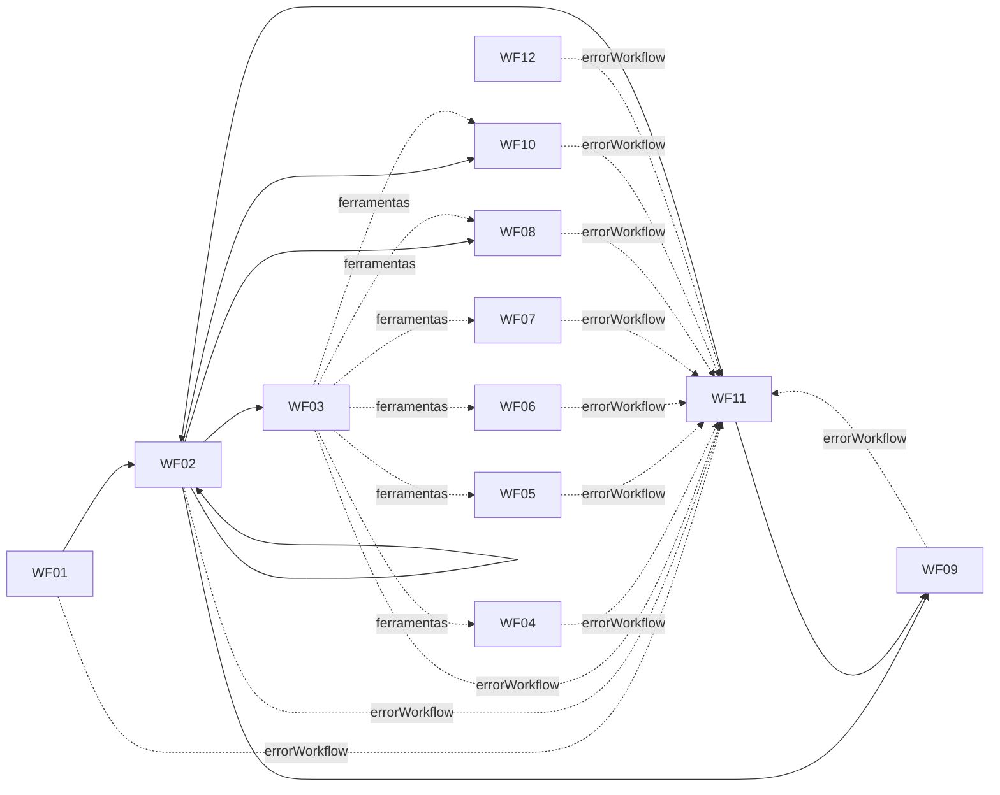

# 09 — Workflows do n8n e configuração de webhooks

Arquivos: `n8n/workflows/wf01…wf12-*.json` — **gerados** por `services/core/scripts/build-n8n-workflows.js` (não editar à mão; regenerar). Versões dos nós conferidas com as definições do n8n **2.44.7**.

## 1. Validação executada (local, dados simulados)

| Verificação | Resultado |
|---|---|
| Importação via CLI (`n8n import:workflow --separate`) dos 12 workflows | ✅ 12 importados |
| Publicação/ativação (`n8n publish:workflow`) | ✅ webhooks (WF01) e agendamentos (WF11, WF12) ativados |
| GET de verificação com token correto/errado | ✅ 200 com `hub.challenge` / 403 |
| POST assinado "Oi" → WF01 → WF02 → WF09 → envio | ✅ saudação enviada (WhatsApp simulado) |
| POST com assinatura inválida | ✅ 401 no core → erro capturado pelo WF11 e registrado mascarado |
| "quero falar com um atendente" | ✅ encaminhamento + 2 mensagens + WF08 (notificação) |
| Mensagem que exige IA, com chave Anthropic inválida | ✅ classificador → saída de erro → agente falha → `/falha` → mensagem de contingência |
| Mensagem que exige IA, com API Anthropic **simulada** | ✅ modelo recebeu 19 ferramentas, `thinking: adaptive`, `effort: medium`, sem `temperature`; chamou `consultar_disponibilidade` → WF05 → core; resposta com valor oficial passou no verificador e foi enviada |

Defeitos encontrados e corrigidos durante a validação: (1) Code node com `getBinaryDataBuffer` falhava no task runner do n8n 2.x → substituído por "Extract From File"; (2) `rawBody` é ignorado quando `noResponseBody` está ativo → removido `noResponseBody`.

**Não validado**: execução com modelo real (qualidade das respostas, custos), Cloud API real, PMS real, modo fila do n8n, carga.

## 2. Credenciais necessárias (criar no n8n de destino com estes nomes)

| Nome da credencial | Tipo | Conteúdo | Usada em |
|---|---|---|---|
| `Core API - servico_n8n` | Header Auth | Nome `Authorization`, valor `Bearer <token do papel servico_n8n>` | Todos os nós que chamam o core |
| `Anthropic - agente hoteleiro` | Anthropic API | Chave da API (e URL base, se usar gateway) | WF03 (modelo e classificador) |

Os arquivos exportados **não contêm credenciais**. URLs de destino de notificação (equipe, DPO, alertas) são definidas na geração (`EQUIPE_WEBHOOK_URL`, `DPO_WEBHOOK_URL`, `ALERTA_WEBHOOK_URL`) e o endereço do core em `CORE_BASE_URL` (padrão `http://core:8080`).

## 3. Ordem de importação e dependências

Importe todos de uma vez (IDs fixos `HotelAgentWfNN00` preservam as referências) e publique. Ordem lógica de ativação: WF11 → WF04–WF10 → WF03 → WF02 → WF01 → WF12.

## 4. Especificação por workflow

### WF01 — Recepção de mensagens
- **Gatilhos**: Webhook `GET /webhook/whatsapp` (verificação) e `POST /webhook/whatsapp` (eventos, `rawBody`, resposta 200 imediata).
- **Entradas**: query `hub.*`; corpo bruto + cabeçalho `x-hub-signature-256`.
- **Processamento**: GET → core `/internal/inbound/verificacao` → responde desafio ou 403. POST → Extract From File (binário → base64) → core `/internal/inbound` (assinatura, normalização, idempotência) → separa conversas → WF02 (sem esperar).
- **Saídas**: 200 para a Meta; execuções de WF02.
- **Erros**: assinatura inválida/erro no core → erro do workflow → WF11.

### WF02 — Gerenciador de conversas
- **Gatilho**: Execute Workflow (`conversa_id`).
- **Processamento**: core `/internal/turnos/iniciar` → Switch `acao`: `interpretar` → WF03 (erro → core `/falha`); `responder`/`silencio` → pós-turno; `enfileirado`/`nada_a_fazer` → fim. Pós-turno: WF09 (se houver mensagens) → WF08 (se `notificar_equipe`) → WF10 (se `notificar_privacidade`) → WF02 novamente (se `ha_pendentes`).
- **Concorrência**: a trava é do core; WF02 pode rodar em paralelo para conversas diferentes.

### WF03 — Agente de IA
- **Gatilho**: Execute Workflow (`turno`).
- **Processamento**: core `/internal/agente/configuracao` (prompt e lista permitida) → monta entrada com `<contexto_conversa>` e `<mensagem_cliente>` (escapando `<` e `>`) → classificação (HTTP para a API Anthropic com saída JSON estruturada, `effort: low`) → core `/classificacao` → se `invocar_agente`: AI Agent (máx. 8 iterações, `claude-opus-5-5`, raciocínio adaptativo, cache de prompt 5 min) com 19 ferramentas → core `/resposta` (verificador de saída). Falhas → core `/falha`.
- **Credenciais**: Anthropic + Core API.

### WF04 a WF07 — Executores de ferramentas por domínio
- **Gatilho**: Execute Workflow (chamado por nós `toolWorkflow` do WF03) com `modo`, `ferramenta`, `turno_id`, `argumentos`.
- **Processamento**: valida que a ferramenta pertence ao domínio e o formato do `turno_id` → core `/internal/ferramentas/{nome}` (cabeçalho `x-turno-id`) → devolve resultado estruturado ao agente.
- WF04: rede (listar, buscar, detalhes, comodidades, políticas, FAQ, contexto). WF05: disponibilidade e cotação. WF06: iniciar reserva, dados do hóspede, preparar confirmação. WF07: verificação, consulta, alteração, cancelamento, estado.
- A **execução** de reserva/cancelamento/alteração não passa por esses workflows: ocorre no core ao receber o clique do cliente (WF01→WF02).

### WF08 — Atendimento humano
- `modo=ferramenta`: `encaminhar_atendimento` via core. `modo=notificar`: POST no canal da equipe com `atendimento_id`/`conversa_id` (sem PII). Retomada da automação apenas via `/admin/atendimentos/{id}/encerrar`.

### WF09 — Comunicação pelo WhatsApp
- **Entrada**: lista de mensagens (com `chave_deduplicacao`).
- **Processamento**: para cada mensagem, core `/internal/saida/enviar` (política completa). `adiada` ou falha retentável → espera (até 60 s) e **uma** nova tentativa com a mesma chave. Não enviada → registro em `/internal/ops/erros`.

### WF10 — Privacidade
- `modo=ferramenta`: `registrar_solicitacao_privacidade`. `modo=notificar`: POST ao canal do encarregado com `solicitacao_id`.

### WF11 — Monitoramento e falhas
- **Error Trigger** (workflow de erro de todos os demais) → mascara → core `/internal/ops/erros` → alerta.
- **A cada 2 min**: core `/internal/ops/varredura` → reprocessa conversas (WF02), avisa clientes sobre reservas reconciliadas (WF09), alertas.
- **A cada 5 min**: core `/internal/ops/saude` → alerta se indisponível.

### WF12 — Retenção e descarte
- **Diariamente 03:00**: core `/internal/jobs/retencao` → resumo com contagens.

## 5. Configuração do webhook na Meta

1. No app da Meta (produto WhatsApp), configurar **Callback URL**: `https://<domínio-do-n8n>/webhook/whatsapp` (HTTPS obrigatório).
2. **Verify token**: o mesmo valor de `WHATSAPP_VERIFY_TOKEN` no core (o n8n apenas repassa o desafio ao core).
3. Assinar o campo **messages** da WABA.
4. Garantir que o **App Secret** configurado no core (`WHATSAPP_APP_SECRET`) é o do app que envia os webhooks.
5. Testar: a Meta envia o GET de verificação; em seguida enviar uma mensagem de teste do número de testes.
6. O proxy reverso não pode alterar o corpo da requisição (a assinatura é calculada sobre o corpo bruto).
7. Exponha publicamente **somente** `/webhook/whatsapp` do n8n e `/verificacao/*` do core; o editor do n8n e as rotas `/internal` e `/admin` do core devem ficar em rede privada/VPN.

## 6. Configurações recomendadas do n8n
`EXECUTIONS_DATA_SAVE_ON_SUCCESS=none`, `EXECUTIONS_DATA_SAVE_ON_ERROR=all`, `EXECUTIONS_DATA_PRUNE=true`, `EXECUTIONS_DATA_MAX_AGE=168`, `N8N_BLOCK_ENV_ACCESS_IN_NODE=true`, `N8N_DIAGNOSTICS_ENABLED=false`, task runners em modo externo em produção, usuários com MFA e acesso ao editor restrito.
